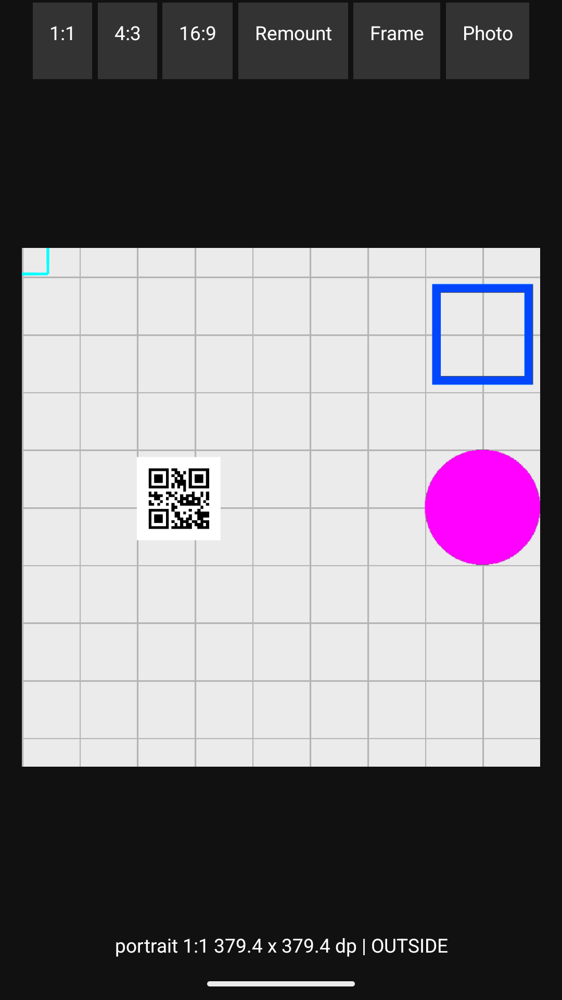

# Android scan-frame layout validation

Related to [#576](https://github.com/teslamotors/react-native-camera-kit/issues/576).
Baseline: `a2a81cee8995c831aca472836e2be446994ba070` (current master when checked).

## Reproduced failure

After mounting an Android camera with `showFrame`, toggle the prop false, then
true without changing the camera's layout. The newly enabled frame appears as
a small corner fragment. This reproduces in square, 4:3 and 16:9 camera views,
in portrait and landscape display orientations.

With camera permission already granted, a minimal reproduction is:

```tsx
import React, { Suspense, useState } from 'react';
import { Button, View } from 'react-native';
import { Camera } from 'react-native-camera-kit';

export default function ScanFrameExample() {
  const [showFrame, setShowFrame] = useState(true);
  return (
    <View>
      <Button title="Toggle frame" onPress={() => setShowFrame(value => !value)} />
      <Suspense fallback={null}>
        <Camera scanBarcode showFrame={showFrame} style={{ width: 300, aspectRatio: 1 }} />
      </Suspense>
    </View>
  );
}
```

`CKCamera.setShowFrame()` directly lays out a new `BarcodeFrame` before adding
it. Its measured dimensions can still be zero. Previously, `frameRect` was
calculated from measured dimensions and only refreshed during `onMeasure()`.
The minimum 100-pixel frame therefore remained centered at local `(0, 0)`.
React Native need not measure the newly added native child again.

The fix calculates the rectangle from actual layout bounds in `onSizeChanged()`.
Custom frame-size changes use the current layout bounds and invalidate the view.

## Emulator measurements

Actual installed release APKs used the example app with a temporary validation
entry containing ratio, remount and frame-toggle buttons. The native camera
sources came from the baseline and this patch respectively. The emulator was
Android 35 Google APIs ARM64, emulator 36.5.11, 1080×1920 at 420 dpi, with hardware
GPU rendering and a 1280×960 image-file camera input containing an 80-pixel square
grid. Landscape used the rotated 1920×1080 display. Screenshots were inspected
and their original pixels measured.

| Orientation | Layout | Preview pixels | Grid X/Y, baseline / patch | Patched frame center error after re-enabling |
| --- | --- | --- | --- | --- |
| Portrait | 1:1 | 996×996 | 1.000000 / 1.000000 | (0, 0) px |
| Portrait | 4:3 | 996×1328 | 1.000000 / 1.000000 | (0, 0) px |
| Portrait | 16:9 | 874×1552 | 1.003876 / 1.003876 | (0, 0) px |
| Landscape | 1:1 | 712×712 | 1.000000 / 1.000000 | (0, 0) px |
| Landscape | 4:3 | 950×712 | 1.000000 / 1.000000 | (0, 0) px |
| Landscape | 16:9 | 1266×712 | 1.000000 / 1.000000 | (0, 0) px |

Initial frames were centered on both versions. All six baseline re-enabled
frames showed a 53×53-pixel corner fragment. All six patched re-enabled frames
retained their initial bounds. For square portrait, the visible cyan border
changed from `(42,476)-(95,529)` to `(145,776)-(935,1172)`, centered at `(540,974)`.

| Baseline after re-enabling | Patch after re-enabling |
| --- | --- |
|  |  |

Preview stretching was not reproduced on current master in these six layouts;
grid spacing differed between axes by at most 0.39%, identically before and
after the patch. A Galaxy A13 was not available; the original Android 13 /
v13.0.0 distortion and first-load report remain unverified on that hardware.

Photo capture through the patched app also saved a valid 60,652-byte, 1280×720
JPEG. The visual runs used React Native 0.81's legacy architecture.

## Automated checks

`BarcodeFrameTest` covers direct layout without measurement, normal measured
layout, resize with stale measured dimensions, and custom/default frame sizes.
The square and portrait/landscape 4:3 and 16:9 sizes are included. The Android
build workflow runs these tests with the example build.

Local validation passed the release example build and release lint checks,
four committed Debug tests with the new architecture, and thirteen Release
layout tests with the legacy architecture (four committed tests plus nine
independent measurement and `CKCamera.setShowFrame()` controls).

```sh
cd example/android
./gradlew :react-native-camera-kit:testDebugUnitTest -PnewArchEnabled=true
./gradlew :react-native-camera-kit:testReleaseUnitTest -PnewArchEnabled=false
```

Local builds used JDK 17 and an external Gradle init script selecting installed
SDK 36 because SDK 34 was absent. The project's SDK setting remains 34.
The baseline TypeScript build passed. Existing JavaScript ESLint and Jest
commands were blocked by missing `eslint-plugin-import` and `jest` respectively.

## Related work and scope

[#710](https://github.com/teslamotors/react-native-camera-kit/pull/710) is merged
and chooses the Android use-case aspect ratio from the viewfinder dimensions.
[#644](https://github.com/teslamotors/react-native-camera-kit/pull/644) changes
iOS resize behavior.

Open [#812](https://github.com/teslamotors/react-native-camera-kit/pull/812)
handles a separate Android barcode-selection coordinate defect: fixed 90°
rotation assumptions and independent axis scaling omit the preview's crop and
sensor transform. Its source leaves `BarcodeFrame` layout unchanged. This patch
addresses visible frame placement and its selection rectangle; the coordinate
transform work remains in #812. Issue #576 should stay open for that broader
investigation and device-specific verification.

A separate local comparison compiled #812 at `d218635` with 54 tests: its 17
existing tests and all 24 independent barcode-selection matrix cases passed,
while seven frame-layout checks failed (including three of the four tests added
here). Composing that source with this frame-layout patch passed all 54 tests.
The coordinate unit tests use supplied detections and authored sensor matrices;
they exercise the compiled native callback, with camera hardware mocked.
